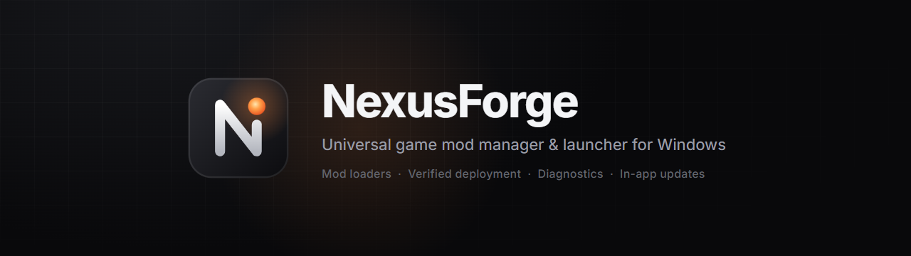

# NexusForge



Universal game mod manager & launcher for Windows. Electron 45 · Vite 8 · React 19 · TypeScript · Tailwind CSS 4 · Framer Motion · Zustand.

## Install

Download `NexusForge-Setup-<version>.exe` from [Releases](https://github.com/desertsaint88/nexusforge/releases/latest) and run it. The installer is not code-signed, so Windows SmartScreen may say "Windows protected your PC": click **More info › Run anyway**. NexusForge installs for your user (no admin rights needed) and keeps its data in `%APPDATA%\NexusForge`.

**Updates** install inside the app: NexusForge checks this repository's releases when it starts (and every few hours). **Update now** downloads the new version with progress (differential when possible, SHA-512 checked), installs it silently, and restarts. Your library, mods, profiles and settings stay. Settings › About & updates shows the state and can turn the check off.

**Bug reports**: the bug button in the title bar, the **Report** button on every error message, the Diagnose tab, failed deployments and the crash screen open a report with system info, recent errors, the end of the log and the game's Diagnose results. Your user folder, user name, e-mail addresses and keys are taken out, and you see the text before anything is sent. It opens as a new issue in this repository, inside NexusForge (sign in to GitHub once) or in your browser; a full copy is saved in `%APPDATA%\NexusForge\bug-reports`. If NexusForge did not close properly, it offers a report at the next start.

## Features

**Library & launcher**
- First-run scan of Steam (every `libraryfolders.vdf` library, playtime and last played from your Steam profile, cached artwork), Epic Games Store manifests, Xbox / Microsoft Store games (`.GamingRoot`, launched by package AUMID), GOG (registry), and your own game folders. A folder of folders is expanded once.
- **Every drive**: "Games"-style folders at each local drive's root, Steam libraries Steam doesn't know about, and the launcher folders in Program Files are scanned without any setup. Release folder names are cleaned ("Hell.Let.Loose.Vietnam.v1.4.1-OFME" → "Hell Let Loose Vietnam").
- **Console games**: disc images in folders without a PC game (e.g. `C:\Games\PS2`) and in PCSX2's game list start in the installed emulator (PCSX2, DuckStation, PPSSPP, Dolphin), with box art from libretro-thumbnails.
- Manual add by `.exe` or folder, with exe detection that skips uninstallers, crash handlers and redistributables.
- Library grid with cover art, playtime, mod count, mod-support badges, favorites, filters (incl. "Mod support" and "Modded"), sort, and a Continue Playing banner. Playtime is tracked for games NexusForge starts, also when a launcher (PlayGTAV.exe, a .bat, steam://) exits right away: the game's own process is followed in its folder (`library/tracker.ts`).
- **Quick search**: Ctrl + K (or the box in the title bar) jumps to any game or page; Ctrl + Enter starts the selected game.
- **Interface size** (Settings › General, Ctrl + / Ctrl - / Ctrl 0, Ctrl + mouse wheel) for small windows and TVs.
- **Artwork**: Steam's local cache first, then the Steam store's *current* pictures from `IStoreBrowseService/GetItems` (newer games keep them under hashed paths; the old plain CDN paths 404), each checked to load before it's used. Games outside Steam are matched by folder name, the exe's product name and Unity's `app.info`, with abbreviations ("FNAF", "GTA", "HLL") and demo/edition suffixes handled; an exact match also fixes the title's spelling ("Hell Let Loose: Vietnam"). Pictures shipped in the game folder (`cover.jpg`, `banner.png`) are the fallback. Every game is re-checked once whenever the lookup improves (`ART_REV`).
- **Startup scan**: every launch looks for new games, then reads every game's folders for installed mods (can be turned off in Settings › Library).
- **Installed-mod detection** (`mods/detect-core.ts`): BepInEx (Thunderstore `manifest.json`, DLL version info), MelonLoader, UE4SS (`mods.txt`), Unreal `.pak` mods (`~mods`, `LogicMods`, `_P.pak`), Garry's Mod addons (`addon.json`, GMA headers), BeamNG (`db.json` with repository ids), Steam Workshop subscriptions (`appworkshop_<id>.acf` + titles), mod.io, Bethesda plugins (`plugins.txt`), BO3 mods/maps (`workshop.json`), X-Plane add-ons, People Playground contraptions, script hooks/ASI/ReShade and plain `Mods` folders. Files NexusForge deployed are recognized from its manifests. Whether a game can be modded comes from presets, loaders, the engine (Unity, Unreal, Source, BeamNG, Bethesda) and anti-cheat (EasyAntiCheat/BattlEye lower the verdict).

**Mod deployment (VFS)**
- Mods are staged in NexusForge's storage and deployed as **symlinks → hardlinks → copies**, falling back per file with a plain-language reason (Developer Mode / admin for symlinks, same drive for hardlinks). A per-game capability check shows what's available.
- Incremental: only changed files are touched. Original game files are moved to a backup and restored on purge. A deployed file the game changed afterwards is moved to an *overwrite* folder instead of being deleted. Paths can't escape the target folder. Every deploy is tracked in a manifest.
- Archives: zip, 7z (bundled 7-Zip), rar/tar (Windows' libarchive), folders, single files. Wrapper folders and `Data/` roots are detected, and the content folder can be changed per mod. Thunderstore packages are re-laid out for BepInEx.
- Drag-and-drop load order (`@hello-pangea/dnd`); later mods win. Profiles per game, each saved as its own JSON file.
- **Conflict resolver**: groups of mods that overwrite the same files, a winner picker per file, and "prefer this mod for the whole group". Pinned choices survive reordering.

**Game integrations & one-click mod loaders** (`src/main/integrations/`)
- Every game gets an integration (`registry.ts`, most specific first): Terraria/tModLoader, Casualties: Unknown, Valheim / Lethal Company / Risk of Rain 2 (BepInEx), GTA V, Cyberpunk 2077, then **any Unity game** and **any Unreal Engine game**, then a generic one. An integration says where mods go, which loader they need, how to install it through its official channel, what to check after deploying and how to read the loader's log after a start.
- The setup panel (Mods tab) has an Install / Update / Repair button per loader; "Set up and deploy" also installs whatever the enabled mods need, the loaders they build on first. Loaders come from their official release channels with the SHA-256 the publisher states (GitHub release digests) and are deployed like mods, so a purge takes them out again:
  - Unity: BepInEx 5 (Mono builds) / BepInEx 6 (IL2CPP), MelonLoader. Which one a mod needs is read from its DLL (it references `BepInEx` or `MelonLoader`).
  - Unreal: `.pak`/`.utoc`/`.ucas` mods into `Content/Paks/~mods`, Blueprint mods into `LogicMods`, UE4SS (3.0.1 for UE4–5.3, `experimental-latest` for newer or unknown engine versions) with Lua/C++ mods switched on through `enabled.txt`.
  - GTA V: Script Hook V from dev-c.com (only when it supports the installed GTA5.exe patch; the download sends dev-c.com's page as Referer, as a click there does), Script Hook V .NET. `.asi` next to GTA5.exe, .NET scripts into `scripts\`. OpenIV packages are refused with the reason.
  - Cyberpunk 2077: Cyber Engine Tweaks, RED4ext, redscript, ArchiveXL, TweakXL, Codeware; a mod's files say which it needs.
  - Terraria: tModLoader through Steam, or its GitHub `tModLoader.zip` for other copies when tModLoader's own start check (`InstallVerifier.cs`: an unmodified `Terraria.exe` of the version a release is made for, no `steam_api.dll`) accepts the copy; NexusForge picks the newest release that does, and never patches that check.
- Works the same for store copies and plain game folders on any drive. **Proxy DLLs** (`proxy.ts`): loaders start through `winhttp.dll` / `version.dll` / `winmm.dll` / `dwmapi.dll` / `dinput8.dll` next to the game. Copies of games often use those names for their own files (Steam or Social Club emulators, OnlineFix's `winmm.dll`); NexusForge reads what each DLL is and never replaces one that is not the loader's: the loader goes in under another name it supports, or the panel says which files are in the way. Anti-cheat (EasyAntiCheat, BattlEye) is shown as a warning; NexusForge does nothing to get past it.

**ReShade for every game** (`src/main/reshade/`, the ReShade tab)
- One click installs ReShade from reshade.me: the setup is checked against ReShade's code-signing certificate and the DLL is unpacked from it without running it. Graphics API and DLL name are worked out the way ReShade's setup does (its compatibility list first, then the executable's imports); files of the game are never replaced. Games whose anti-cheat bans ReShade (per that list) are refused.
- Standard or add-on build (a mod that is a ReShade add-on switches it), shader packs from ReShade's own list, overlay key, active preset (a preset that comes with a mod becomes active until you pick one), performance mode, depth settings from the compatibility list.
- **Last start** reads ReShade.log: loaded or not, attached to the game, effects that failed to compile, add-ons. A copy under a name the game never loads is flagged with a fix (GTA V loads `dxgi.dll` from System32, so ReShade goes in as `ReShade64.asi` through Script Hook V's ASI loader). A ReShade installed by hand can be taken over; it is kept as a backup and comes back when NexusForge's copy is removed.
- Mods that bundle their own ReShade use the managed one; archives with one folder per program ("GTA V/" next to "Minecraft/") install only the folder for the game.

**Verification & diagnostics** (details: [docs/INTEGRATIONS.md](docs/INTEGRATIONS.md))
- Results say what was actually checked: **verified** (files in place and the integration checked the game will load them), **deployed, loading not confirmed** (files in place and checked, nothing more is knowable), failed / rolled back. Nothing is shown as loaded until the loader's log says so.
- **Shared package strategies** for every game, before the game's own rules: setup programs are never copied into a game (*Run installer* starts one after asking), save games go into the game's real save folder in a free slot or are not deployed, mods for closed mod managers (NexusTools) are recognized instead of spread over the game folder, ReShade presets are flagged when ReShade isn't installed.
- **Runtime evidence per mod** from the loader's log after a start: Script Hook V / Script Hook V .NET per script (including the API version a script needs: then the official SHVDN nightly is offered), BepInEx per plugin, and the tModLoader, MelonLoader, UE4SS, CET and redscript logs where they name files. Games without such a log say so.
- **Diagnose tab** per game: installation, deployment journal, files missing or changed on disk, packages that weren't deployed, missing/outdated loaders, the integration's own checks and runtime evidence, each with a code (`NF-…`), confidence and evidence. Detection never changes anything; fixes (deploy again, install/update loader, set the deploy folder, run installer, remove a broken entry) ask first and re-check afterwards. *Export report* writes Markdown with the user folder, user name, e-mail addresses and tokens taken out.
- GTA V: save games go into the copy's own profile folder (Rockstar or the RUNE Social Club emulator); script mods' data folders go into `scripts\` and their source code stays out.

**Mod sources**
- Adapter interface (`ModSourceAdapter`) with Nexus Mods, Steam Workshop (SteamCMD), Thunderstore, mod.io, CurseForge, ModDB, Modrinth, the BeamNG repository and mod loaders (BepInEx, MelonLoader from GitHub) built in. Requirements are resolved recursively and installed first.
- **Sorting**: Best match, Top rated, Most downloaded (all time and recent), Trending and Recently added/updated. Each source sorts on its side where it can (Nexus GraphQL with date windows for trending/recent, mod.io `_sort`, CurseForge `sortField`, Workshop `browsesort` + `days`, Thunderstore/Modrinth orderings, BeamNG and ModDB list orders); otherwise NexusForge sorts the results and says so. Short lists are completed instead of shown nearly empty (`sources/listing.ts`): when a site's Trending / Popular window (Nexus 7 / 28 days, Workshop 1 week / 30 days) holds fewer than 20 mods, the list looks further back (30 and 90 days, a year, all time), still in the site's order; ModDB's rating list (only mods with enough votes) continues with the rest by downloads. A line above the list says which. Mods already installed in the game are marked in the list and the details, with an "Installed" filter.
- Modrinth only has Minecraft content, so it answers "not on Modrinth" for other games instead of listing Minecraft mods.
- **Accounts**: Nexus Mods, mod.io and CurseForge sign-in happens inside the app (the site's login page in the site panel). Afterwards NexusForge reads the personal API key from the site's key page, checks it against the site's API and stores it encrypted. Pressing Download while signed out asks to sign in first. Steam: SteamCMD signs in once with name + password (+ Steam Guard); the password is never stored.
- **Cloudflare**: site pages use Electron's own user agent. Posing as Google Chrome made Cloudflare Turnstile fail (error 600010) because the rest of the fingerprint is Electron's; honest, the check passes by itself. If a check still fails, NexusForge clears that site's Cloudflare cookies and retries once, then offers "Open in my browser". Accounts can also be signed in through the user's own browser: the key page opens there and the copied key is picked up from the clipboard (only while that sign-in is running, only strings shaped like the site's key).
- Downloads never leave the app: pages that need a click (Nexus "Slow download" for free accounts, bot checks) open in the in-app site panel with the button highlighted, and the file installs as soon as it lands.
- BeamNG.drive mods stay zipped and go to BeamNG's user folder (`startup.ini` `UserPath` respected).
- Custom JSON feeds (URL or local file) and trusted JavaScript plugins. See [docs/PLUGINS.md](docs/PLUGINS.md).
- Download manager with progress, speed, time left, cancel, retry, per-entry remove, and auto-install into the chosen game. Page downloads (Nexus "Slow download") keep their page open in the background until the file is complete, and a dropped connection resumes where it stopped. Progress shows on the taskbar button (yellow + flashing when a download waits for your click); finished installs notify while NexusForge is in the background.
- **Mod updates** (`mods/updates.ts`): mods installed from a source are checked against the site's files (cached 30 min, "Check for updates" in the Mods menu). Files only replace files of the same channel (a Nexus main file the newest main file, an optional file only newer uploads of itself). "Update all" or the version badge downloads the new file, which replaces the old copy in place (same load-order position and enabled state).
- **Load more**: Nexus, Steam Workshop, Thunderstore, mod.io, CurseForge, ModDB, Modrinth and the BeamNG repository continue their lists page by page in the site's own order.

**Security & logging**
- Context isolation, sandboxed renderer, no Node in the renderer, an allow-listed preload bridge, IPC sender checks, a production CSP, denied permission requests, external links opened in the browser, and images served through a scheme that returns image files only.
- API keys are encrypted with Windows DPAPI (`safeStorage`). Plugins only load after you trust them, and trust resets when their code changes.
- `electron-log` writes to `%APPDATA%\NexusForge\logs\main.log`.

## Develop

```powershell
npm install          # also downloads the Electron binary
npm run dev          # hot-reloading app
npm run typecheck
npm test             # unit tests (deploy engine, conflicts, scanners, archive layouts)
npm run build
npm run smoke        # end-to-end run of the built app with screenshots in .smoke/shots
node scripts/smoke-sources.mjs   # live checks against the real mod sites (.smoke/sources/shots)
node scripts/probe-reshade-ui.mjs    # ReShade tab screenshots for games of the real library (read-only copy of the data file)
node scripts/e2e-reshade.mjs         # ReShade flow end to end on a stand-in GTA V folder (fix, remove, a mod that needs ReShade)
node scripts/smoke-cloudflare.mjs  # Nexus login/registration pass Cloudflare inside the app (no automation driver)
npx vitest run --config scripts/live/vitest.live.config.ts   # live checks: real loader downloads, real starts of a copied game, this PC's library (read-only)
node scripts/probe-diagnostics.mjs   # Diagnose on a copy of the real data file (game folders only read), reports in .smoke/diagnostics
node scripts/probe-bugreport.mjs     # bug reports end to end (crash prompt, preview, saved report, GitHub form) + update check
npm run dist         # NSIS installer in release/ (not published)
npm run release      # dist + scripts/release.mjs: draft release, upload installer/blockmap/latest.yml (digest-checked), publish
                     # raise "version" in package.json and push first; token from GH_TOKEN or Git's stored GitHub login
node scripts/live/update-e2e.mjs <older NexusForge-Setup.exe> <released version>
                     # real update test: installs the older build in .smoke, lets it update itself from GitHub, uninstalls it
```

Checks that need the dev PC's own setup (games its library must list, games to screenshot, a local Terraria or mod download) read `scripts/local.json`, which stays out of git; see `scripts/local.example.json`. Without it they are skipped.

Build an older test installer without publishing it: `npx electron-builder --win --publish never -c.extraMetadata.version=1.6.9 -c.directories.output=release-test`.

A release holds the installer, its `.blockmap` (differential updates) and `latest.yml` (version, SHA-512); installed copies read `latest.yml` to update.

`npm run smoke` uses a throwaway data folder and a fake game under `.smoke/`; it never deploys into real games.
Set `NEXUSFORGE_SMOKE_FOLDERS="C:\Games;E:\Games"` to also scan those folders (read-only).
`NEXUSFORGE_USER_DATA` points the app at a different data folder (testing / portable use).

## Layout

```
src/main        Electron main process
  library/      scanners (steam, epic, xbox, gog, custom), artwork, presets, launching
  mods/         archive install, layout detection, shared package strategies (classify.ts), runtime evidence
                (runtime.ts), plan/conflicts, deploy engine, profiles
  diagnostics/  read-only checks (core.ts), confirmed repairs, report export with redaction
  bugreport/    error capture (logger hook, crashes), session marker, report text + GitHub issue form
  updater/      update checks and in-app installs from GitHub releases (electron-updater)
  integrations/ per-game and per-engine integrations, mod loaders (zip-loader.ts), proxy DLL checks, one-click setup
  sources/      adapter interface, Nexus/Thunderstore/Modrinth, feeds, plugin loader
  downloads/    download manager
src/preload     context bridge (allow-listed channels)
src/shared      types + typed IPC contract
src/renderer    React UI (pages, components, zustand stores)
tests/          vitest
```

## Data

Everything lives in `%APPDATA%\NexusForge`: `nexusforge.json` (library, settings, mod metadata), `mods/` (staging, configurable), `profiles/<game>/<profile>.json`, `deployments/<game>.json` (manifests), `backups/`, `overwrite/`, `downloads/`, `plugins/`, `logs/`, `bug-reports/`, `session.json` (did the last session close properly). Updates and uninstalls leave this folder alone; downloaded updates are cached in `%LOCALAPPDATA%\nexusforge-updater`.
